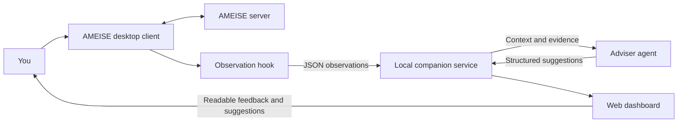

# AMEISE adviser integration and web companion

This replaces the earlier agent-control proposal. The workflow is now **observe → explain → advise → human decision**. The existing AMEISE desktop client remains the application that communicates with the simulator and submits the user's actions.

A Rust receiver and web dashboard are provided in [adviser/](../adviser/). They accept observation packets, display readable feedback, expose context to an external adviser, and validate its suggestions against a documented command policy. A separate patched client launcher publishes observations, and a separate Rust runner invokes a model adapter. Starting the dashboard alone does not start either process.

**Implementation status:** the receiver runs in Rust with the v2 event/advice contracts and SQLite tables. The client patch and continuous runner have synthetic integration tests; a designated live game and an authenticated model call still require operator validation.

For a live run, the desktop client must keep sending its original Java messages to the configured AMEISE server **and** publish separate, redacted JSON observations to the local adviser API. An adviser process then polls that API for new context and posts advice back to it. The original simulator transport and the adviser HTTP API have different protocols and purposes; the same serialized packet cannot simply be sent to both addresses.

## 1. Data flow and responsibilities



The observation hook copies information already sent or received by the desktop client. It does not create another simulator session. The receiver, browser, and adviser do not send simulator commands, answer simulator callbacks, log into AMEISE, or advance time. A suggested command can be copied and entered manually in the legacy client.

The web dashboard is a companion for understanding the game. It presents activity, feedback, pending questions, supporting evidence, and the command guide. It is not a replacement simulator transport or an implementation of the simulator's rules.

| Component | Responsibility |
| --- | --- |
| Existing desktop client | Login, selected game, simulator communication, command submission, polling, callbacks and its existing macro behavior. |
| Observation hook | Publish immutable, redacted copies of observed messages asynchronously. |
| Local receiver | Validate/store events, separate streams, expose context, validate adviser output and mark old advice stale. |
| Web dashboard | Translate packets into readable cards, inspect raw data, import recordings and show permitted suggestions. |
| Adviser process | Review evidence, identify uncertainty, propose appropriate allowed actions and explain why. |
| Human | Decide what to do and submit it through the desktop client. |

There is no `command.execute`, `command.answer`, `game.select`, or simulator-login endpoint in this API. The previous request schema and control examples have been replaced by observation and advice schemas. The new packet version is the string `"2"`.

## 2. Run the local companion

From the repository root, use the development shell, which supplies Cargo, Rust and JDK 8:

```sh
nix develop --command ./adviser/run.sh
```

Alternatively, with Cargo available:

```sh
./adviser/run.sh
```

The launcher builds and runs the Rust receiver using the committed Cargo lockfile. The first build downloads dependencies. After building, `adviser/target/debug/ameise-adviser` runs directly without Cargo, while the repository supplies the dashboard assets and contracts.

Open **http://127.0.0.1:8765**. The service serves the dashboard and API from the same local origin. It binds to loopback; it is not intended to be published to Sites hosting or a public server. The interface starts without live data. **Load demo** imports clearly marked synthetic events and example advice. **Import packets** accepts a JSON object, JSON array, or JSONL recording.

The launcher's command-line options include `--port` and `--data-dir`. Runtime state is stored beneath `adviser/.runtime/` by default; keep recordings separate from source and credentials. See `./adviser/run.sh --help` for the implemented options.

Starting the companion does not attach to `ClientV50.jar`, start an LLM, or generate real game observations. Start the patched client and runner separately as described below, or POST a sample event/import a recording to exercise the receiver and UI.

### Existing SQLite data

Stop any previous receiver using the data directory, then start `./adviser/run.sh` with the same `--data-dir` (the default remains `adviser/.runtime/`). The Rust receiver opens the existing `adviser.sqlite3` directly: the `streams`, `events` and `advice` table definitions are unchanged. No export, reset or destructive migration is performed. Duplicate checks compare parsed JSON values, preserving compatibility with existing records. Keep a copy of the data directory after stopping the service if you want a rollback backup.

The Rust tests cover validation, persistence, existing table compatibility, and actual HTTP requests against the Rust binary. See section 11 for commands.

## 3. HTTP API

Use UTF-8 JSON with `Content-Type: application/json` for POST requests. JSONL is an import/recording format; the event endpoint accepts one JSON event per request. Invalid events receive a structured error and are not added to the stream.

| Endpoint | Producer/consumer | Behavior |
| --- | --- | --- |
| `GET /api/v2/health` | Launcher/browser | Reports service status and `simulator_control: false`. |
| `POST /api/v2/events` | Desktop observation hook/importer | Accepts one validated observation. New event: 201. Identical retry: 200. |
| `GET /api/v2/state?stream_id=...` | Browser | Returns selected stream, event history, advice, policy and observation quality. Without a stream ID, selects the most recently updated stream. |
| `GET /api/v2/context?stream_id=...` | Adviser | Returns the observed game/turn, current revision, evidence, policy and uncertainty for review. |
| `POST /api/v2/advice` | Adviser | Submits structured observations and suggestions tied to a specific stream revision. |
| `GET /api/v2/policy` | Browser/adviser | Returns the full command catalog and recommendation restrictions. |
| `GET /api/v2/examples` | Demo loader | Returns synthetic packets and example advice. It does not query AMEISE. |

The dashboard polls local state roughly every two seconds. An adviser may also poll context and review only when its revision changes. Neither kind of polling sends AMEISE requests.

Errors use `{ "error": { "code": string, "message": string } }`. Typical HTTP classifications are 400 for invalid data or forbidden recommendations, 404 for an unknown stream/route and 409 for conflicting event identity, stale context or incomplete evidence. Do not interpret a receiver rejection as failure of an action in the simulator: the receiver observes actions after they happen.

## 4. Observation packet contract

The [event schema](adviser-event.schema.json) is the machine-readable contract. [Example packets](adviser-events.jsonl) are synthetic recordings, not responses captured from a live server.

```json
{
  "api_version": "2",
  "event_id": "evt_demo_002",
  "stream_id": "stream_demo",
  "sequence": 2,
  "occurred_at": "2026-10-28T16:00:01Z",
  "source": "demo",
  "kind": "command.sent",
  "game": { "game_id": 17, "tournament_id": 4, "model_instance_id": 9 },
  "turn_id": 42,
  "payload": {
    "request_id": "observed_request_001",
    "command": "Bernd and Stefanie review specification"
  }
}
```

The ID/time values above are illustrative. `event_id` identifies an immutable event; keep it unchanged on delivery retries. `stream_id` identifies one observed game/branch session, not an authenticated server connection. Create a new stream on game selection or a user-driven restart/branch switch. Ordinary command progression stays in the same stream. Keep the original numeric game, tournament, model-instance and turn identifiers; do not increment turn IDs locally. Use `turn_id: null` when the client has not established one.

`sequence` starts at 1 within each stream and is allocated before events enter the publisher queue, so dropped packets leave a detectable gap. `occurred_at` is a UTC observation timestamp; the simulation's date is a separate raw string. `source` distinguishes `ameise_client`, `import`, and `demo` records. It is a provenance label, not proof that imported data came from a trusted client.

| Event kind | Required payload | Readable meaning |
| --- | --- | --- |
| `game.selected` | `name`, `simulation_date_raw` | A game was selected or an observation stream began. |
| `command.sent` | `request_id`, `command` | The desktop client sent a command; its result/effect is not yet established. |
| `command.result` | `request_id`, `command`, `feedback`, `kernel_output_raw`, `simulation_date_raw` | A terminal result and its raw feedback were observed. It may acknowledge a queued action rather than completed work. |
| `callback.requested` | `request_id`, `command`, `question`, `choices`, `previous_answer_ids` | The simulator asks for a selection; the human answers in the desktop client. |
| `transport.uncertain` | `request_id`, `command`, `message` | The client could not establish the result. Explain the uncertainty; do not replay the command. |

Callback choices contain numeric `id` and text `label` values. Preserve the real choice IDs and the full previous answer sequence. Array position is not a choice ID. The optional `alternatives_raw` string preserves unmodified upstream alternatives. If they cannot be parsed, publish `choices: []` with that raw text; the event still represents a pending question requiring human attention. A new callback for the same request replaces the displayed pending question; the eventual matching terminal result resolves it.

`request_id` correlates one emitted `CommandObject` and its poll/callback chain across send and result events. It is observation metadata created by the hook; the upstream DTOs do not supply a general JSON request identifier. Preserve it across that command's polling and callback exchanges. Every next emitted `CommandObject` gets a new ID, including each wire step of a user macro or multi-day Proceed. Keep `payload.command` as the original sent text for that command throughout; upstream result/callback strings are not proven byte-for-byte equal, and a mismatched command under the same request ID is treated as uncertain evidence.

The receiver accepts observations of any command, including excluded ones that the human used in the desktop client. Command restrictions filter **recommendations**, not history. Unknown or undocumented command text can still be observed; it cannot become a structured adviser recommendation without an explicit catalog entry.

Example ingestion from the repository root:

```sh
head -n 1 docs/adviser-events.jsonl | curl --fail-with-body \
  -H 'Content-Type: application/json' \
  --data-binary @- http://127.0.0.1:8765/api/v2/events
```

An acknowledgement reports `accepted`, `duplicate`, `stream_id` and the stream's receiver `revision`. It confirms storage in the companion, not an action's completion in AMEISE.

## 5. Ordering, duplicates, gaps and freshness

An identical `event_id` with the identical packet is idempotent. Reusing an ID for a different packet, or assigning different packets the same stream/sequence, is a conflict. The game identity is fixed within a stream. The receiver accepts out-of-order events and displays them by sequence.

Each unique ingestion increases the receiver's stream `revision`, including a late event with a lower sequence. This is why advice uses a revision instead of only the latest event ID. An adviser that reviewed revision 5 must not publish recommendations as current after revision 6 arrives.

State/context responses contain `quality.missing_sequences`, `quality.uncertain`, and `quality.truncated`. The current service returns all stored events; `truncated` means the missing-sequence detail list exceeded its 1000-entry display bound, not that stored history was omitted. Missing events, an unresolved sent command, a pending callback or an unresolved transport outcome must be treated as incomplete knowledge. When evidence is incomplete, the adviser can return observations and missing-information questions, but the receiver rejects executable command recommendations.

Old advice remains visible as history and is marked `stale`. The browser disables copying stale recommendations. Reading stale advice never refreshes it. Review the new context before issuing an updated suggestion.

The receiver's history contains only observations delivered to this companion. It is not a complete authoritative copy of all simulator state. A review's defect count, a developer's current task, budget totals or document quality must be shown as unknown unless an observed response supports the value. Do not calculate them from acknowledgement text or from how many commands were sent.

## 6. Adviser output contract

An external adviser reads `/api/v2/context`, then submits the [advice schema](adviser-advice.schema.json). [Example advice](adviser-demo-advice.json) demonstrates the shape. [Agent instructions](../adviser/AGENT_GUIDELINES.md) provide a reusable operating policy.

Advice contains `api_version`, `advice_id`, `stream_id`, `based_on_revision`, `policy_version`, `source`, `summary`, `observations`, `recommendations`, and `missing_information`. Each observation and recommendation cites `evidence_event_ids` from that stream. Recommendations use a catalog `command_id` and typed `arguments`, not a free-form command string. The receiver validates the policy and renders exact syntax itself.

For example, a recommendation entry can be:

```json
{
  "command_id": "show_specification",
  "arguments": {},
  "reason": "Inspect the specification before deciding whether to change the review plan.",
  "evidence_event_ids": ["evt_demo_003"]
}
```

Use the command IDs from the live policy response; this isolated object is not a complete POST body and does not establish that a command is currently available in a particular game.

The service verifies matching stream/revision/policy, known evidence IDs, recommendation eligibility, required arguments, value types and developer/document choices. It rejects extra arbitrary command fields, duplicate reviewers and multiline/control characters in text arguments. Text arguments are limited to 1–256 printable characters; a dynamic `report_name` must appear literally in the cited result's feedback or raw output. Numeric values are restricted to signed 64-bit integers. Only entries with `recommendation: "allowed"` can appear as suggested commands. Evidence references establish traceability; they do not automatically prove the model's reasoning or that a matching substring is a usable report name. The agent must still distinguish observations, assumptions and prerequisites.

The saved advice response includes `created_at`, computed `stale`, and `rendered_recommendations` with the exact command text. The browser may copy current permitted text for the human. There is no apply/execute endpoint behind that copy action.

Agent scheduling should use one active review per stream, a short quiet period after a burst of packets and a revision check just before submission. Repeated polling of unchanged context does not need another model call. A 409 for stale context means fetch and review the newer context; it does not authorize resubmitting an old recommendation with a new revision number.

## 7. Which commands may be recommended?

The [command policy](adviser-command-policy.json) is a full catalog grounded in [docs/README.md](README.md) and the [QA 200 command list](AMAISE_commandlist-qa200-en-v1.95.pdf). It contains all 42 PDF command forms plus one-day Proceed and retains commands even when the adviser cannot recommend them. The PDF distinguishes a clickable label from the actual syntax in parentheses; the latter is used in rendered suggestions.

| Classification | Adviser behavior | Default scope |
| --- | --- | --- |
| `allowed` | May recommend with relevant evidence and satisfied prerequisites; the human still executes manually. | Inspection/status, ordinary work, reviews, corrections, tests, staffing hires, customer meetings and one-day Proceed. |
| `manual_only` | Explain in the command guide; do not emit it as a proposed command. | `deliver system`, `fire <name>`, and notation changes. |
| `excluded` | Retain for understanding observed history; never recommend it. | `finish project`, `<name> quit activity`, `<name> finish activity`, `finish review document`. |

The README discourages `finish project`, `quit activity` and `finish activity`, particularly on an initial run. The PDF describes `finish review document` as aborting a review. Excluding these is the default adviser policy. Making delivery, firing and notation changes manual-only is an additional product choice to preserve deliberate human decisions; it is not a claim that the PDF forbids them.

Proceed is a client action described in the README and implemented in the existing client; it is not an entry in the PDF's three-page list. The initial recommendation policy limits it to `proceed 1`, preserving a chance to inspect intermediate feedback. The legacy client retains its existing automatic initial Proceed and multi-day behavior; the observer records what actually happens and does not alter it.

Commands being documented does not mean they are appropriate now. A recommendation must account for known hiring/activity state, document authorship, review membership, prerequisites, pending callbacks, missing feedback and current game phase. The README advises reviewers who did not author the artifact and warns that a second assignment can be delayed or lost when a developer is busy. If that context is absent, ask for an inspection or report missing information rather than asserting availability.

The catalog is the permitted recommendation vocabulary, not a reimplementation of the simulator's rule engine. If a runtime dictionary is later captured, it should further restrict the catalog, never silently expand it. Policy changes require a version change and revalidation of advice. All observations remain readable even if the policy changes later.

## 8. Web interface behavior

The local page provides:

- A stream selector, observation status and clear demo/import/live provenance.
- A readable activity timeline separating sent commands, returned feedback and unanswered questions.
- Adviser notes with evidence references, missing information and copyable permitted suggestions.
- A searchable command guide with allowed/manual-only/excluded filters, exact syntax and source/restriction explanations.
- A raw JSON inspector and packet import for troubleshooting and recorded sessions.
- A context export/copy option for an external agent.

There are no simulator controls in the browser. A pending callback directs the human to answer in AMEISE. Unknown metrics remain unknown. An agent that has not submitted advice is shown as absent/waiting; demo advice is labeled as example content. The normal viewer is deterministic and does not require an LLM to translate packet structure into readable cards.

Render imported feedback as text, preserving original strings in the inspector. The simulator output uses `@P`, `@W`, `@E` segments and control character 30 in some paths; display normalization may split these into readable lines but must not suppress warnings/errors. JSON strings and adviser prose are untrusted content for HTML rendering.

## 9. Build and run the observed ClientV50

The original client is [Client-engine4/ClientV50.jar](../Client-engine4/ClientV50.jar), launched by [launch_client.sh](../launch_client.sh). The observer build uses JDK 8's bundled ASM **at build time** to insert six small hook calls into the original `SendingUnit` and `LogicalUnit` bytecode. It adds the independently compiled [ObservationHook](../adviser/client/src/ameise/observer/ObservationHook.java) and packages a separate `ClientV50-observer.jar`. It does not rebuild the decompiled tree. The build verifies every original JAR entry: apart from those two client classes, all bytes, including the manifest, resources and serialized DTOs, must match. The build fails on an unexpected hook count or signed input JAR.

```sh
nix develop --command ./adviser/client/build.sh
nix develop --command ./launch_observed_client.sh
```

`launch_observed_client.sh` builds the patched copy if absent. Re-run `build.sh` after changing hook code or replacing the original JAR. The original launcher still runs the original JAR. To compare patched behavior with observation disabled:

```sh
AMEISE_OBSERVER_ENABLED=false ./launch_observed_client.sh
```

Set `AMEISE_OBSERVER_URL` to change only the observer destination (default `http://127.0.0.1:8765/api/v2/events`). The 256-packet memory queue retries the same immutable event with 1-second connection and 1.5-second read timeouts and bounded backoff. Full queues and rejected packets are reported locally; sequence numbers are allocated before enqueueing. There is no disk spool: exiting the client loses undelivered packets. Keep the receiver running for capture. No passwords, account identities or serialized `PersonData` objects are copied into the observation envelope.

Callbacks preserve raw alternatives and the complete numeric previous-answer sequence. **Structured choices are currently empty** because real callback fixtures have not established a safe parser; the dashboard directs the human to the original dialog. The legacy parser and callback submission behavior remain in the original client.

The two destinations must remain independent:

| Destination | Existing or new behavior | Data sent |
| --- | --- | --- |
| AMEISE server from [configClient.xml](../Client-engine4/configClient.xml) | Keep the current socket, request ordering, callbacks, polling and original `MessageObject` serialization. | The original simulator requests and replies. |
| Adviser receiver, default `http://127.0.0.1:8765/api/v2/events` | Separate, bounded background HTTP publisher with an independently configurable URL. | JSON event v2 copies containing only the allowed observation fields. |

Do not redirect the simulator socket, open a second simulator session, send a duplicate simulator command, or POST raw Java objects to the adviser. A local adviser failure must never determine whether an AMEISE request succeeds.

The hook implements these observation points (receive hooks run after successful original processing and before GUI delivery can start another macro step):

1. **Selection:** after a successful continue-game response has established game/model/turn state, start a stream and enqueue `game.selected`. Preserve the returned original game/tournament identity. Do not publish passwords, password hashes, usernames, email addresses or entire `PersonData` objects. A user-driven restart or branch switch begins a new stream.
2. **Send:** in [SendingUnit.executeRequest](../ClientV50/sources/ameise/client/SendingUnit.java), leave the socket write/flush to `centralUnit.serverAddress/serverPort` in place. Once the write succeeds, enqueue `command.sent` from its `CommandObject` without waiting for the HTTP POST. Allocate one observation `request_id` per emitted `CommandObject` before submission and preserve it while that command's interaction is pending. Callback-answer messages continue the same observed request. Each later macro or multi-day Proceed wire step gets its own ID.
3. **Receive:** observe `CommandResultObject` and `CallbackResultObject` in [ReceivingUnit](../ClientV50/sources/ameise/client/ReceivingUnit.java) and [LogicalUnit](../ClientV50/sources/ameise/client/LogicalUnit.java) after receiving the original simulator reply. Enqueue `command.result` with raw feedback/date, or `callback.requested` with the actual numeric choice IDs. Preserve the original reply path into the GUI. Wait hints and polling remain inside the existing client; do not publish a wait hint as a terminal result.
4. **Failure:** when a write/read timeout or connection loss leaves the simulator outcome uncertain, enqueue `transport.uncertain` if possible. A missing final event also leaves an unresolved sent command visible in the dashboard. Never retry a simulator action from the observer publisher.
5. **Publication:** allocate `sequence` before placing each immutable event in a bounded queue; assign a stable `event_id`, UTC `occurred_at`, the current `stream_id`, game identity and observed turn ID. A background worker POSTs the event as UTF-8 JSON to `/api/v2/events` with short connection/read timeouts. Queue/network failure must not block Swing's event thread, change return values, skip normal message handling or terminate the simulator client. Report dropped observations locally; sequence gaps make incomplete evidence visible to the receiver.

The publisher may retry sending **the same observation packet** using its stable event ID. This is distinct from retrying the original simulator command. Keep the packet in a small local spool if reliable delivery across companion restarts is needed, and replay it in sequence when possible.

The existing protocol uses `MessageObject(2, RequestManagerObject(2, CommandObject))` for commands, type 3/result 2 for terminal results, type 3/result 1 for callbacks, and type 3/result 3 for wait hints. These are the observation points; JSON packets must never be written onto the simulator's object-stream socket.

For callback alternatives, the original parser has one-digit assumptions. Preserve the original alternatives when adapting it, and validate numeric ID parsing with real fixtures before publishing selectable choices. If choices cannot be interpreted, explain that limitation rather than inventing IDs or answering automatically. The packet shape permits `choices: []` to represent unavailable structured options while the human uses the original dialog.

## 10. Run a continuous adviser

The API server listens; the agent is an HTTP **client** of that server. Start an agent runner on the same machine, or in an environment that can reach the configured loopback address. Give it [AGENT_GUIDELINES.md](../adviser/AGENT_GUIDELINES.md), the live [policy](adviser-command-policy.json), and the [advice schema](adviser-advice.schema.json). A one-off interactive agent turn can review once, but the guidelines file alone does not start a process or keep one alive. Continuous advice requires a persistent runner or scheduler around model invocations.

### Included model runner

The included runner reviews streams serially, polls every two seconds, and waits one second for a quiet revision. It supplies the full context, policy, advice schema, project README and agent guidelines to an adapter. The supplied OpenAI adapter uses the [Responses API JSON output format](https://developers.openai.com/api/docs/guides/structured-outputs?api-mode=responses); schema and policy validation remain local. It requests `store: false`, exposes no model tools, and reads credentials only from the environment.

With `OPENAI_API_KEY` and `OPENAI_MODEL` already set in your shell:

```sh
nix develop --command ./adviser/run-agent.sh
```

Choose a model available to your API account that supports Responses JSON mode. This command sends the observed game context to OpenAI for review. It runs until Ctrl-C; no model calls are made merely by starting the receiver. Options include `--url`, `--poll-seconds`, `--quiet-seconds` and `--model-timeout`. The default model timeout is 180 seconds. Ctrl-C cancels polling and terminates the active adapter process.

To use a different provider, run the Rust runner with your adapter executable:

```sh
cargo build --locked --manifest-path adviser/Cargo.toml --bins
adviser/target/debug/adviser-runner -- /absolute/path/to/model-adapter arg1
```

The adapter reads one UTF-8 JSON object from stdin until EOF containing `instructions`, `project_rules`, `advice_schema`, and `context`. It writes exactly one complete v2 advice JSON object to stdout, diagnostics to stderr, and exits nonzero on failure. The runner validates the returned identity and replaces `advice_id` with a fresh transport ID. It rejects command recommendations from uncertain context before submission. Lost POST responses retain the exact draft; saved agent advice avoids duplicate reviews after restart. Invalid model output is logged and is not repeatedly regenerated at the same revision during that runner session. Restart the runner after fixing an adapter failure to retry an unreviewed revision.

The runner's loop should:

1. Poll `GET /api/v2/context` at a modest interval (for example, two seconds). Keep one active review per stream and remember which `stream_id`/`revision` has already been reviewed. On restart, consult the saved `advice` in context so the same revision is not posted again.
2. When a new revision appears, wait briefly for a burst of related packets, fetch context again, and invoke the model only if that revision is still current. Read the complete policy and evidence, not just the latest packet. If the context reports uncertainty, the model may submit observations and missing-information notes but no command recommendations.
3. Have the model produce one object conforming to the advice schema with `source: "agent"`, a fresh `advice_id`, the reviewed `stream_id`, `based_on_revision`, `policy_version` and evidence event IDs. Re-fetch context before posting; if its revision or policy changed, discard the draft and review again. Otherwise POST it to `/api/v2/advice`. The receiver validates and displays it; the runner must not submit simulator commands.
4. If the POST returns `stale_advice` or `policy_conflict`, fetch new context and perform a new review. If a POST response is lost, retry the **same advice body and ID** so the receiver can recognize a duplicate. If the local service is unavailable, back off and retry the read later. Stop cleanly when the operator stops the runner; do not spin or invoke the model repeatedly on an unchanged revision.

Start the receiver before the patched desktop client and runner when possible. Launch the runner separately; `./adviser/run.sh` starts only the receiver and dashboard. The observer should tolerate the receiver being temporarily unavailable; the runner should tolerate an empty stream until a game is selected. The human reads current advice in the dashboard and executes chosen actions in the original desktop client.

## 11. Validation and completion boundaries

The implemented receiver/dashboard can be checked locally without a simulator account. Use the backend tests from the repository root:

```sh
cargo test --locked --manifest-path adviser/Cargo.toml
./adviser/client/test.sh
```

The Java test script creates a local mock receiver (including temporary failure), verifies the patched classes with `-Xverify:all`, checks retry identity, callback history, wire-step IDs, restart streams and disabled publication, then feeds those generated packets through the Rust store. HTTP tests require permission to bind loopback sockets. No test contacts a simulator or calls a paid model.

Validate both JSON schemas, the synthetic events/advice, exact policy-template arguments, event deduplication/conflicts, cross-stream evidence, late events/revisions, stale advice, excluded/manual-only suggestions, pending questions, uncertain outcomes and the absence of execution routes. For the browser, verify empty/demo/import states, responsive layout, filters, raw inspection, copy behavior and stale/unknown labels.

Live integration requires a patched client JAR, not just edited decompiled source. With the observer disabled and with the adviser receiver unavailable, compare the patched client's simulator behavior to the original. Then observe a designated game, compare captured send/result/callback sequences with the dashboard, and verify that each client request still reaches the configured AMEISE server once. Exercise callback questions, multi-day Proceed, lost observation packets, receiver restart and a stale advice revision. Finally run the agent loop long enough to verify one review per changed revision, evidence-backed advice in the dashboard, and no model calls while context is unchanged. Neither live connection nor model execution is implied by the demo.

## 12. Source map

| Concern | Reference |
| --- | --- |
| Rules and discouraged actions | [README.md](README.md), especially Using the simulator and Managing people, time, and cost |
| Original client launcher and server destination | [launch_client.sh](../launch_client.sh), [configClient.xml](../Client-engine4/configClient.xml) |
| Exact labels, syntax and abort behavior | [Command list PDF](AMAISE_commandlist-qa200-en-v1.95.pdf), pages 1–3 |
| Client TCP send/flush | [SendingUnit.java](../ClientV50/sources/ameise/client/SendingUnit.java), `executeRequest` |
| Reply handling, wait hints and polling | [ReceivingUnit.java](../ClientV50/sources/ameise/client/ReceivingUnit.java), `receive`, `run`, `poll` |
| Game selection state and terminal objects | [LogicalUnit.java](../ClientV50/sources/ameise/client/LogicalUnit.java), `getObject`, `processDBObject`, `processResultObject` |
| Command/result/callback contents | [Communication package](../ClientV50/sources/ameise/shared/communication/) |
| GUI callback behavior, initial/multi-day Proceed | [SimulationPlus.java](../ClientV50/sources/ameise/client/components/SimulationPlus.java), `makeObject`, `processAnswerObject`, `processDistributedObject` |
| Callback IDs and previous answers | [CallbackList.java](../ClientV50/sources/ameise/client/components/CallbackList.java), `valueChanged`, `addElementToOldAnswers` |
| Output and alternatives parsing | [ParsingTool.java](../ClientV50/sources/ameise/client/util/ParsingTool.java), `filter`, `parseAlternatives` |
| Runtime dictionary and hidden commands | [SimulationGUIPlus.java](../ClientV50/sources/ameise/client/components/SimulationGUIPlus.java), `setDictionaryAndParameters` |
| Rust receiver, validation and HTTP routes | [src/lib.rs](../adviser/src/lib.rs), [src/validation.rs](../adviser/src/validation.rs), [src/http.rs](../adviser/src/http.rs) |
| Client patch build and fixtures | [client/build.sh](../adviser/client/build.sh), [client/test.sh](../adviser/client/test.sh) |
| Continuous runner and model adapter | [src/runner.rs](../adviser/src/runner.rs), [openai-adapter.rs](../adviser/src/bin/openai-adapter.rs), [run-agent.sh](../adviser/run-agent.sh) |
| Agent operating instructions | [AGENT_GUIDELINES.md](../adviser/AGENT_GUIDELINES.md) |
